<div align="center">


# Expenser

**Quản lý chi tiêu cá nhân — tối giản, nhanh, mã nguồn mở.**
<br />
*A fast, open-source personal expense tracker with a modern minimalist interface.*

[](https://expenser-quan-ly-chi-tieu.vercel.app/)


[Dùng thử](https://expenser-quan-ly-chi-tieu.vercel.app/) ·
[Tính năng](#-tính-năng) ·
[Cài đặt](#-bắt-đầu) ·
[Nhắc nhở hàng ngày](#-nhắc-nhở-hàng-ngày-thông-báo-đẩy) ·
[Thiết kế](#-hệ-thống-thiết-kế)

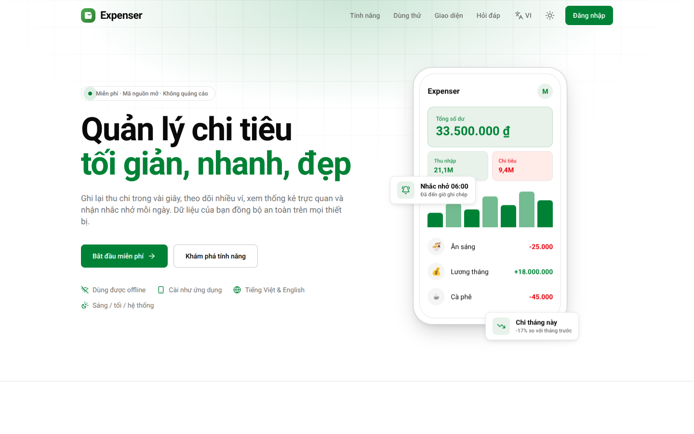

</div>

---

## Mục lục

- [Giới thiệu](#-giới-thiệu)
- [Ảnh chụp màn hình](#-ảnh-chụp-màn-hình)
- [Tính năng](#-tính-năng)
- [Công nghệ](#-công-nghệ)
- [Bắt đầu](#-bắt-đầu)
- [Nhắc nhở hàng ngày (thông báo đẩy)](#-nhắc-nhở-hàng-ngày-thông-báo-đẩy)
- [Scripts](#-scripts)
- [Hệ thống thiết kế](#-hệ-thống-thiết-kế)
- [Luồng điều hướng](#-luồng-điều-hướng)
- [Cấu trúc dự án](#-cấu-trúc-dự-án)
- [Mô hình dữ liệu](#-mô-hình-dữ-liệu)
- [Triển khai](#-triển-khai)
- [Trình duyệt hỗ trợ](#-trình-duyệt-hỗ-trợ)
- [Giấy phép](#-giấy-phép)

## 📖 Giới thiệu

**Expenser** giúp bạn ghi lại thu chi trong vài giây, theo dõi nhiều ví, xem thống kê trực quan và xuất báo cáo (PDF / Excel / ảnh). Ứng dụng ưu tiên thao tác một tay trên điện thoại, cài được như ứng dụng thật (PWA), vẫn dùng được khi mất mạng và nhắc bạn ghi chép mỗi ngày.

| | |
| --- | --- |
| 🎨 **Giao diện tối giản** | Nền phẳng, viền mảnh, ít đổ bóng; chế độ sáng / tối / theo hệ thống và màu nhấn tùy chọn. |
| ⚡ **Nhập liệu nhanh** | Gợi ý số tiền một chạm: gõ `2` → `2.000 · 20.000 · 200.000 · 2.000.000`. |
| 🔔 **Nhắc nhở hàng ngày** | Thông báo đẩy đẹp mắt, bật/tắt và đổi giờ trong Cài đặt (mặc định 06:00). |
| 🌐 **Song ngữ** | Tiếng Việt / English, ngày giờ và tiền tệ tự định dạng theo ngôn ngữ. |
| 📴 **Offline-first** | PWA cài lên màn hình chính, Firestore lưu đệm và tự đồng bộ khi có mạng. |
| 🔓 **Mã nguồn mở** | Phát hành theo giấy phép MIT. |

## 🖼️ Ảnh chụp màn hình

| | | |
| :---: | :---: | :---: |
| <br/>**Trang giới thiệu** | 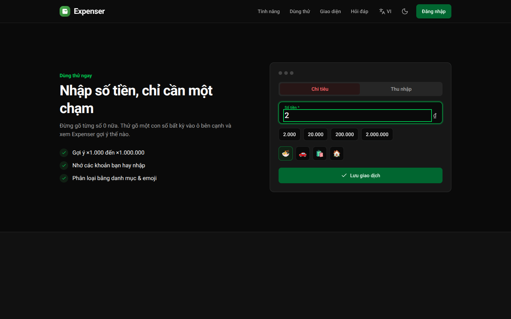<br/>**Dùng thử nhập số tiền (tối)** | 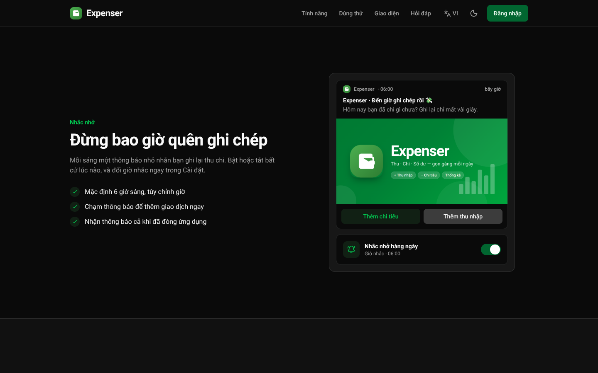<br/>**Thông báo nhắc nhở (tối)** |
| 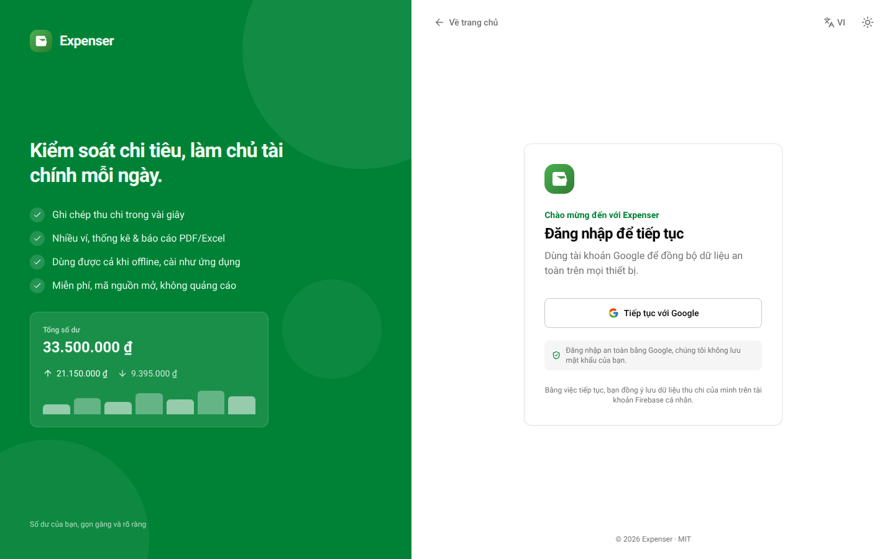<br/>**Đăng nhập** | 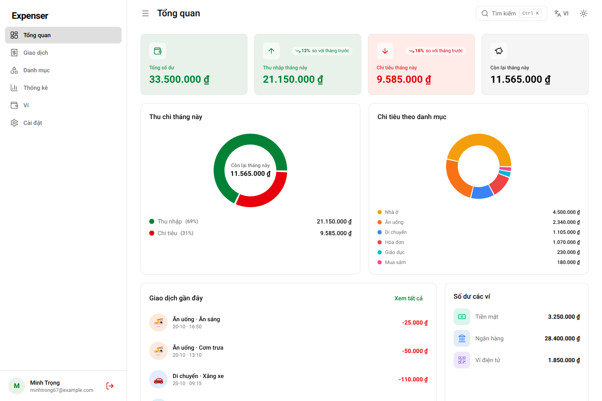<br/>**Tổng quan** | 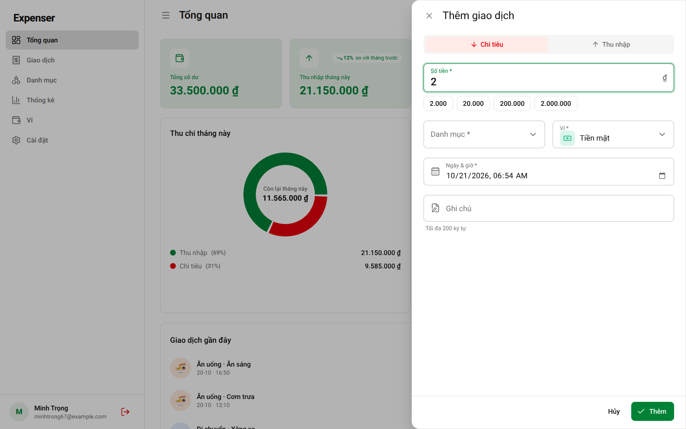<br/>**Thêm giao dịch + gợi ý số tiền** |
| 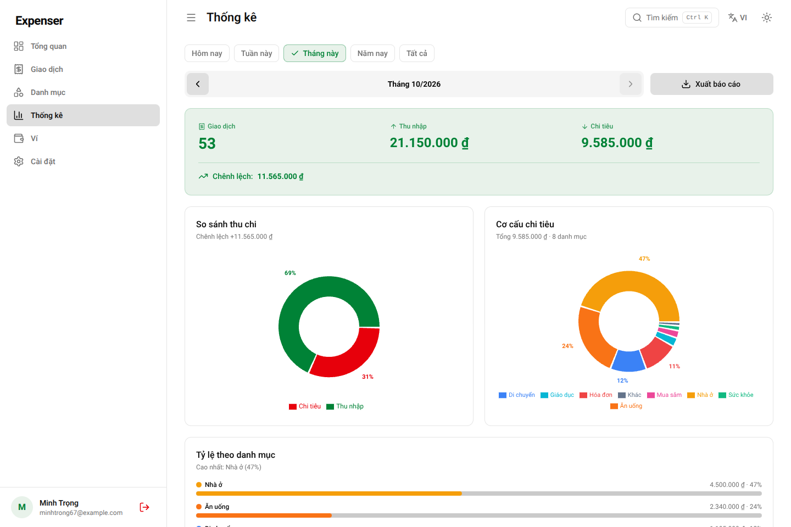<br/>**Thống kê** | 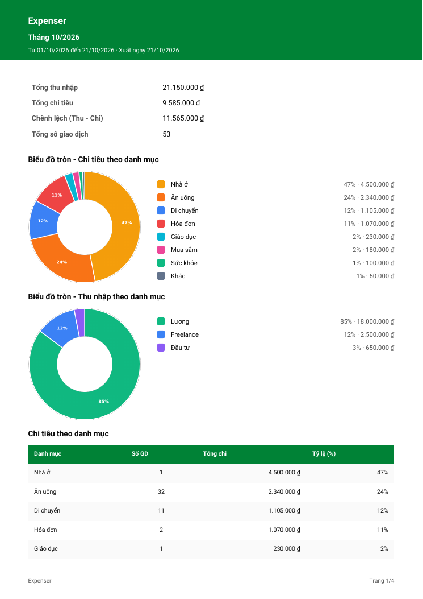<br/>**Báo cáo PDF có biểu đồ tròn** | 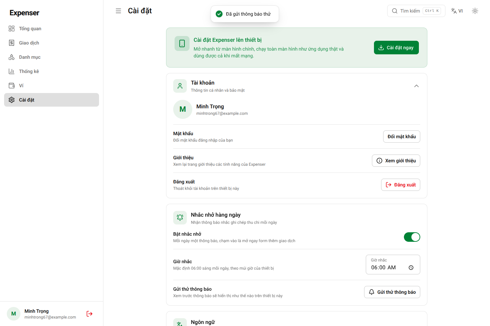<br/>**Cài đặt: nhắc nhở & toast** |
| 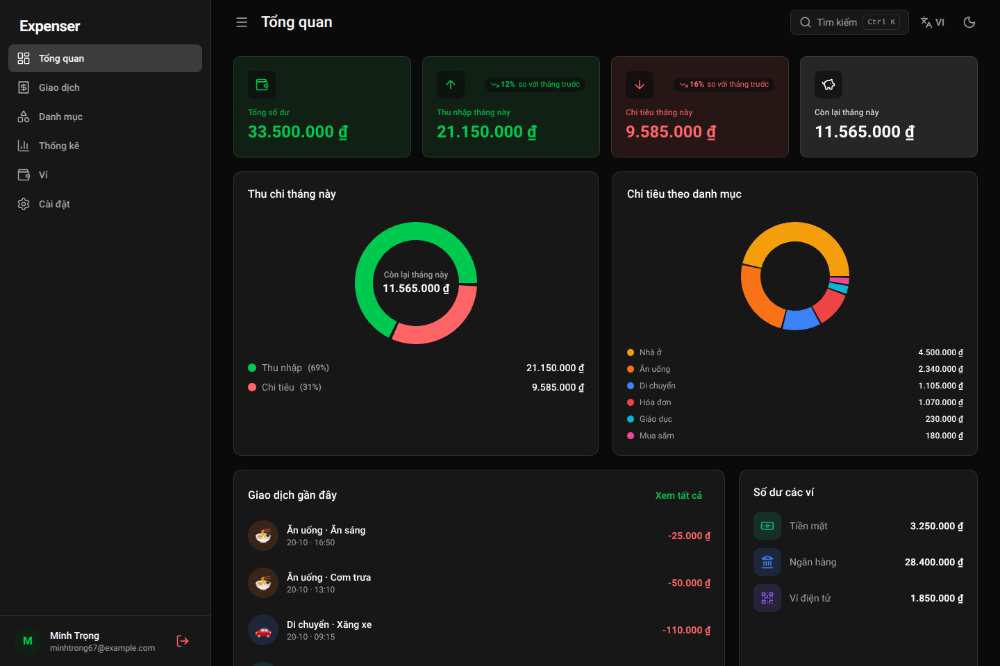<br/>**Chế độ tối** | 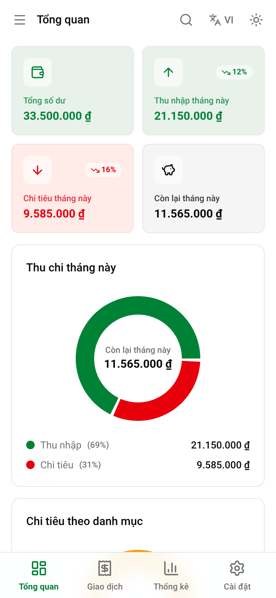<br/>**Giao diện di động** | 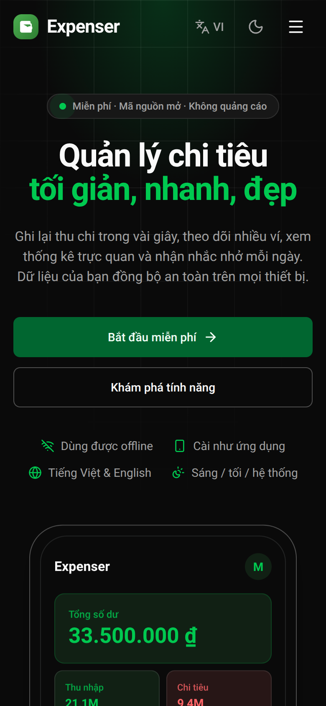<br/>**Trang giới thiệu trên di động (tối)** |
| <br/>**Tiếng Anh** | 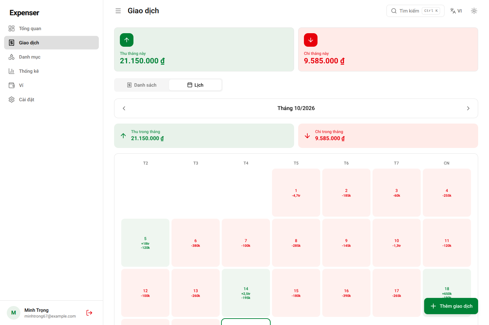<br/>**Lịch giao dịch** | 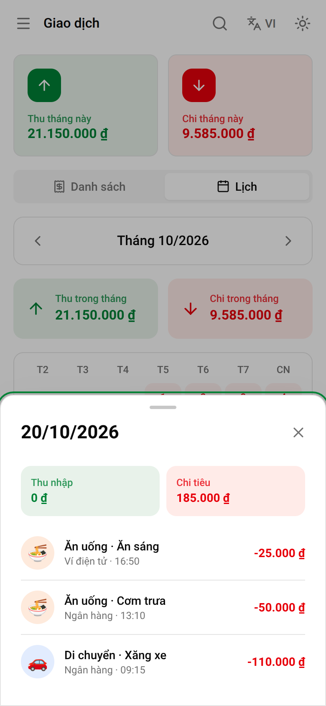<br/>**Chi tiết một ngày (di động)** |

## ✨ Tính năng

### Quản lý tài chính

| Tính năng | Mô tả |
| --- | --- |
| **Tổng quan** | Số dư, thu/chi tháng này (so với tháng trước), biểu đồ tròn, cơ cấu chi tiêu, giao dịch gần đây và số dư từng ví. |
| **Giao dịch** | Xem dạng danh sách (nhóm theo ngày) hoặc lịch tháng; lọc, tìm kiếm, sắp xếp; vuốt phải để sửa, vuốt trái để xóa; tự tải thêm khi cuộn. |
| **Nhập nhanh** | **Gợi ý số tiền**: gõ `2` để chọn `2.000`, `20.000`, `200.000` hoặc `2.000.000`; gõ `25` ra `25.000 … 25.000.000`. Có thêm gợi ý các mục đã nhập gần đây (số tiền, danh mục, ví). |
| **Danh mục** | Thêm / sửa / xóa danh mục thu và chi với emoji và màu tùy chỉnh. |
| **Nhiều ví** | Số dư từng ví và chuyển tiền giữa các ví. |

### Thống kê & báo cáo

- Lọc theo **Hôm nay / Tuần này / Tháng này / Năm nay / Tất cả**, điều hướng sang kỳ trước/sau.
- Biểu đồ xu hướng, so sánh thu–chi và biểu đồ tròn theo danh mục.
- Xuất báo cáo **PDF / Excel / ảnh PNG**, tất cả đều có biểu đồ tròn.
- Nhập / xuất **giao dịch** và **danh mục** riêng biệt (CSV, Excel `.xlsx`, JSON) cùng nút **Xuất tất cả**; nhập hàng loạt nhanh nhờ ghi theo lô.

### Trải nghiệm

- **Trang giới thiệu (landing)** là trang mặc định cho khách chưa đăng nhập: responsive đầy đủ, sáng/tối/hệ thống, Việt/Anh, hiệu ứng cuộn mượt, ô nhập số tiền dùng thử ngay và thẻ SEO đầy đủ. Người đã đăng nhập vào thẳng ứng dụng; nút **Giới thiệu** trong Cài đặt mở lại trang này.
- **Đăng nhập** bằng Google với giao diện chia đôi chuyên nghiệp, có nút quay về trang chủ.
- **Nhắc nhở hàng ngày**: bật/tắt và chỉnh giờ trong Cài đặt, nút *Gửi thử thông báo* để xem trước.
- **Toast** theo đúng giao diện: nền sáng ở chế độ sáng, nền tối ở chế độ tối, đổi màu ngay khi chuyển theme.
- Chế độ **Sáng / Tối / Theo hệ thống**, **màu nhấn** (8 màu gợi ý hoặc chọn bất kỳ), cỡ chữ 3 mức.
- Form nhiều trường mở dạng sheet toàn màn hình; form ngắn và hộp xác nhận dùng dialog; không tự focus để tránh bật bàn phím.
- Bộ lọc từng trang và trạng thái các mục Cài đặt được nhớ trong phiên.
- Tìm kiếm nhanh **Ctrl + K**; hoạt ảnh gọn nhẹ, tôn trọng `prefers-reduced-motion`.
- **PWA**: cài lên màn hình chính, dùng offline, màn hình khởi động dùng nền mặc định, không kiểm tra sáng/tối.
- Truy cập tốt: nhãn ARIA, điều hướng bàn phím, bẫy focus trong hộp thoại.

## 🧰 Công nghệ

| Thành phần | Công nghệ |
| --- | --- |
| Frontend | React 19, Vite 8, React Router 7 |
| Giao diện | Tailwind CSS 3, token màu `oklch` trong `theme.css`, font hệ thống, lucide-react |
| Backend | Firebase Authentication + Cloud Firestore (persistent cache) |

| Biểu đồ | Recharts |
| Xuất / nhập | jsPDF + autoTable, ExcelJS, PapaParse, html2canvas |
| PWA | vite-plugin-pwa (Workbox) |
| Công cụ | oxlint, script kiểm tra i18n |

## 🚀 Bắt đầu

**Yêu cầu:** Node.js ≥ 18 và một dự án [Firebase](https://console.firebase.google.com/).

```bash
git clone <repo-url>
cd expenser
npm install
```

**1. Tạo Firebase project**

1. Firebase Console → **Add project**.
2. **Authentication → Sign-in method**: bật **Google**.
3. **Firestore Database → Create database**.
4. **Project settings → Your apps → Web app**: sao chép `firebaseConfig`.

**2. Biến môi trường** — sao chép `.env.example` thành `.env` rồi điền:

```env
VITE_FIREBASE_API_KEY=xxxxx
VITE_FIREBASE_AUTH_DOMAIN=xxxxx.firebaseapp.com
VITE_FIREBASE_PROJECT_ID=xxxxx
VITE_FIREBASE_STORAGE_BUCKET=xxxxx.appspot.com
VITE_FIREBASE_MESSAGING_SENDER_ID=xxxxx
VITE_FIREBASE_APP_ID=xxxxx

# Tùy chọn - chỉ cần khi muốn thông báo đẩy khi đã đóng ứng dụng (xem phần bên dưới)
VITE_VAPID_PUBLIC_KEY=
```

**3. Security Rules** — dán nội dung [`firestore.rules`](firestore.rules) vào tab **Rules** (mỗi người dùng chỉ đọc/ghi dữ liệu của chính mình; thêm quy tắc cho collection `reminders`).

**4. Authorized domains** — *Authentication → Settings → Authorized domains*: thêm `localhost` và tên miền triển khai.

**5. Chạy thử**

```bash
npm run dev
```

## 🔔 Nhắc nhở hàng ngày (thông báo đẩy)

Trong **Cài đặt → Nhắc nhở hàng ngày**, người dùng có thể bật/tắt thông báo, chọn giờ (mặc định **06:00** theo múi giờ thiết bị) và bấm **Gửi thử thông báo** để xem trước.

Thông báo được thiết kế riêng: biểu tượng ứng dụng, huy hiệu đơn sắc trên thanh trạng thái, ảnh banner khi mở rộng, nội dung xoay vòng theo ngày bằng tiếng Việt hoặc Anh, hai nút hành động **Thêm chi tiêu / Thêm thu nhập**, và chạm vào thông báo sẽ mở thẳng form thêm giao dịch (`/?add=expense`, `/?add=income`).

Ứng dụng dùng ba đường gửi, tự chọn đường tốt nhất có sẵn:

| Cách | Khi nào hoạt động | Cần cấu hình |
| --- | --- | --- |
| **Web Push** (khuyên dùng) | Cả khi ứng dụng đã đóng | Khóa VAPID + Vercel Function + bộ hẹn giờ (bên dưới) |
| **Periodic Background Sync** | Chrome/Android, PWA đã cài, giờ không chính xác tuyệt đối | Không |
| **Hẹn giờ trong trang** | Khi ứng dụng đang mở hoặc chạy nền | Không |

Cả ba dùng chung một `tag` nên mỗi ngày chỉ hiện một thông báo.

### Bật Web Push trên Vercel

1. Sinh khóa VAPID: `npm run vapid` (in ra *public key* và *private key*).
2. Đặt `VITE_VAPID_PUBLIC_KEY` (public key) vào `.env` và **Environment Variables** của Vercel.
3. Thêm các biến **chỉ dùng phía máy chủ** trên Vercel:

   | Biến | Ý nghĩa |
   | --- | --- |
   | `FIREBASE_SERVICE_ACCOUNT` | JSON service account (Firebase Console → Project settings → Service accounts), dán trên một dòng |
   | `VAPID_PUBLIC_KEY` / `VAPID_PRIVATE_KEY` | Cặp khóa ở bước 1 |
   | `VAPID_SUBJECT` | `mailto:ban@example.com` |
   | `CRON_SECRET` | Chuỗi bí mật dài, ngẫu nhiên |
   | `REMINDER_WINDOW_MINUTES` | (tùy chọn) Trễ tối đa vẫn gửi, mặc định 90 |

4. Triển khai lại, rồi **gọi `/api/send-reminders` mỗi ~10 phút**, ví dụ:
   - **GitHub Actions** (miễn phí): dùng sẵn [`.github/workflows/reminders.yml`](.github/workflows/reminders.yml), chỉ cần thêm secret `REMINDER_URL` (`https://<tên-miền>/api/send-reminders`) và `CRON_SECRET`.
   - Vercel Cron (gói Pro cho phép chạy thường xuyên hơn 1 lần/ngày) hoặc dịch vụ như cron-job.org, gửi kèm header `Authorization: Bearer <CRON_SECRET>`.

> Gói Hobby của Vercel chỉ cho cron chạy một lần mỗi ngày nên cần bộ hẹn giờ bên ngoài như trên.

Mỗi thiết bị bật nhắc nhở lưu một tài liệu trong collection `reminders` (đăng ký push, giờ, múi giờ, ngôn ngữ). Tài liệu bị xóa khi người dùng tắt nhắc nhở, đăng xuất, hoặc khi dịch vụ push báo đăng ký đã hết hạn.

**Lưu ý nền tảng:** trên iPhone cần iOS 16.4+ và phải *Thêm vào Màn hình chính* trước khi cấp quyền thông báo. Nếu trình duyệt đang chặn thông báo, Cài đặt sẽ hiển thị hướng dẫn mở lại.

## 🛠️ Scripts

| Lệnh | Tác dụng |
| --- | --- |
| `npm run dev` | Dev server tại `http://localhost:5173` (thêm `-- --host` để mở trên điện thoại cùng mạng LAN). |
| `npm run build` | Build production vào `dist/` (kèm service worker). |
| `npm run preview` | Chạy thử bản build. |
| `npm run lint` | Kiểm tra code bằng oxlint. |
| `npm run i18n:check` | Kiểm tra mọi khóa dịch có đủ ở `vi.js` và `en.js`. |
| `npm run vapid` | Sinh cặp khóa VAPID cho thông báo đẩy. |

**Thêm / sửa văn bản:** mọi chuỗi hiển thị nằm trong [`src/i18n/vi.js`](src/i18n/vi.js) và [`src/i18n/en.js`](src/i18n/en.js). Dùng `const t = useT()` rồi `t('khóa', { n: 3 })`; trong tiếng Anh, khóa kết thúc `_one` là dạng số ít khi `n === 1`.

## 🎨 Hệ thống thiết kế

Phong cách **modern minimalist**: nền phẳng, viền mảnh thay cho đổ bóng, góc bo nhỏ, màu nhấn xanh lá duy nhất.

**Token màu — một nguồn duy nhất.** Toàn bộ biến màu nằm trong [`src/theme/theme.css`](src/theme/theme.css) (`:root` = sáng, `.dark` = tối, giá trị `oklch`): token nền (`--background`, `--primary`, `--card`, thang zinc `--n-*`…) và các token vai trò dẫn xuất từ chúng (`--md-*`, `--brand`, `--on-solid`, `--shadow-color`) mà Tailwind và component dùng (`bg-surface`, `text-on-surface-variant`, `bg-card`, `border-line`, `text-brand`…). `src/index.css` và `tailwind.config.js` không chứa giá trị màu nào, nên sửa file theme là cả ứng dụng đổi theo.

| Việc cần làm | Sửa ở đâu |
| --- | --- |
| Đổi bảng màu | Các biến trong `src/theme/theme.css` (màu chủ đạo: Tailwind `green-500` `#22c55e`; nền/viền/chữ: thang trung tính `--n-50 … --n-950` (zinc của Tailwind v4) khai báo ở đầu file theme — sáng `n-50`, tối `n-800`) |
| Đổi độ bo góc | `--radius` trong `src/theme/theme.css` |
| Thêm / đổi màu nhấn gợi ý | `ACCENT_PRESETS` trong `src/theme/index.js` |

**Màu nhấn.** Mặc định là đúng theme. Khi người dùng chọn màu khác, chỉ `primary`, `chart-*` và `sidebar-primary` bị ghi đè theo hue của màu đó, với độ sáng/độ bão hòa lấy từ dải xanh lá của theme để luôn đủ tương phản ở cả chế độ sáng và tối.

**Toast & tooltip.** Dùng biến `--popover`, `--popover-foreground`, `--border` nên luôn khớp giao diện sáng/tối và đổi màu tức thì khi chuyển theme.

**Không splash screen, màu status bar theo theme.** Ứng dụng không có màn hình splash riêng: khi đang tải chỉ hiện nền theme. `public/manifest.webmanifest` không khai báo `theme_color` / `background_color` (vite-plugin-pwa bị tắt phần tự sinh manifest vì mặc định của nó tự chèn `theme_color` xanh lá `#42b883`). Thẻ `<meta name="theme-color">` được tạo lúc chạy từ màu nền trong `theme.css` và đổi theo sáng/tối nên status bar luôn khớp với trang.

## 🧭 Luồng điều hướng

| Đường dẫn | Khách (chưa đăng nhập) | Đã đăng nhập |
| --- | --- | --- |
| `/` | **Trang giới thiệu** | **Tổng quan** (vào thẳng, không qua trang giới thiệu) |
| `/welcome` | Trang giới thiệu | Trang giới thiệu (mở từ Cài đặt → Giới thiệu) |
| `/login` | Đăng nhập | Chuyển về `/` |
| `/transactions` `/categories` `/wallets` `/statistics` `/settings` | Chuyển tới `/login` | Trang tương ứng |

Đăng xuất luôn đưa người dùng về trang giới thiệu.

## 📂 Cấu trúc dự án

```
expenser/
├── api/
│   └── send-reminders.js     # Vercel Function: gửi Web Push nhắc nhở hàng ngày
├── .github/workflows/        # Bộ hẹn giờ gọi /api/send-reminders
├── public/
│   ├── sw-push.js            # Xử lý push / nhấp thông báo trong service worker
│   ├── notif-banner.png      # Ảnh banner của thông báo
│   ├── icons/ · favicon.*    # Icon PWA, huy hiệu thông báo, favicon
│   └── og-image.png · robots.txt · sitemap.xml
├── screenshots/              # Ảnh minh họa cho README
├── scripts/check-i18n.mjs    # Kiểm tra đồng bộ từ điển vi/en
├── src/
│   ├── components/
│   │   ├── layout/           # AppLayout, Sidebar, Topbar, MobileNav, CommandPalette
│   │   ├── ui/               # Button, Modal, MoneyInput, TextInput…
│   │   └── *.jsx             # Form giao dịch / danh mục / ví, bộ lọc, lịch
│   ├── contexts/             # Auth, Settings (giao diện + ngôn ngữ), Data (Firestore)
│   ├── hooks/                # useReminder, useInView, useSessionState, usePwaInstall…
│   ├── i18n/                 # vi.js, en.js, hook useT
│   ├── pages/                # Landing, Login, Dashboard, Transactions, Categories, Wallets, Statistics, Settings…
│   ├── routes/               # ProtectedRoute (kèm landing cho khách), PublicRoute, ProtectedShell
│   ├── services/reminders.js # Đăng ký push, lịch nhắc, nội dung thông báo
│   ├── theme/                # theme.css (toàn bộ biến màu) + index.js (màu nhấn)
│   ├── utils/                # format, validators, exportImport, pieChart…
│   ├── firebase.js · firestore.js
│   └── main.jsx · App.jsx · index.css
└── firestore.rules · vercel.json · vite.config.js · tailwind.config.js
```

## 🗄️ Mô hình dữ liệu

```
users/{uid}
  ├── transactions/{id}  { type, amount, categoryId, walletId, date, note }
  ├── categories/{id}    { name, type, emoji, color }
  └── wallets/{id}       { name, icon, color, balance }

reminders/{uid}_{hash}   { uid, enabled, time, tz, lang, subscription, lastSentDate, updatedAt }
```

## 📦 Triển khai

```bash
npm run build
```

Triển khai thư mục `dist/` cùng thư mục `api/` lên **Vercel** (đã có `vercel.json`: SPA rewrite không chặn `/api`, cache header, chuyển hướng `/landing.html` → `/welcome`). Nhớ thêm tên miền triển khai vào **Authorized domains** của Firebase Auth. Nếu không dùng Vercel, ứng dụng vẫn chạy tĩnh được (Firebase Hosting, Netlify…) 

SEO & chia sẻ mạng xã hội: thẻ Open Graph / Twitter Card, canonical, JSON-LD (`WebApplication`), `robots.txt` và `sitemap.xml` đã có sẵn cho `https://expenser-quan-ly-chi-tieu.vercel.app/`; ảnh chia sẻ là `public/og-image.png` (1200×630).

## 🌍 Trình duyệt hỗ trợ

Giao diện dùng `oklch()` và `color-mix()`, yêu cầu trình duyệt hiện đại: **Chrome / Edge 111+**, **Safari 16.4+**, **Firefox 113+**. Thông báo đẩy cần trình duyệt hỗ trợ Push API (Chrome, Edge, Firefox, Safari 16.4+ với PWA đã cài).

## 📄 Giấy phép

Phát hành theo giấy phép **[MIT](LICENSE)** — bạn có thể tự do sử dụng, sao chép, chỉnh sửa và phân phối, kể cả cho mục đích thương mại, miễn là giữ lại thông báo bản quyền.

---

<div align="center">

**Expenser** được phát triển bởi **minhtrong67** với sự hỗ trợ của AI **Claude** (Anthropic).

⭐ Nếu thấy hữu ích, hãy tặng dự án một ngôi sao nhé!

</div>
